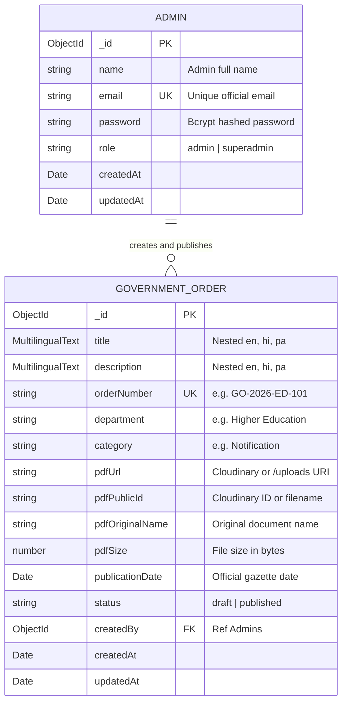

# Database Schema & Data Dictionary

## e-RajPatra: Real-Time Multi-Lingual Government Order Publishing Platform

---

## 1. Entity-Relationship Overview

The database uses MongoDB with two primary collections:
1. **`Admins`**: Stores administrative accounts authorized to manage and publish government orders.
2. **`GovernmentOrders`**: Stores trilingual orders, departmental categories, publication dates, and PDF metadata.



---

## 2. Collection Specifications

### 2.1 Collection: `admins`

| Field | Type | Required | Constraints / Validation | Description |
|---|---|---|---|---|
| `_id` | `ObjectId` | Yes | Auto-generated PK | Unique identifier |
| `name` | `String` | Yes | Trimmed, non-empty | Administrator full name |
| `email` | `String` | Yes | Unique, lowercase, valid email regex | Administrative email address |
| `password` | `String` | Yes | Minimum 6 characters (hashed via bcrypt) | Hashed password |
| `role` | `String` | Yes | Enum: `['admin', 'superadmin']`, default: `'admin'` | Access tier |
| `createdAt` | `Date` | Yes | Timestamp | Record creation time |
| `updatedAt` | `Date` | Yes | Timestamp | Last update time |

#### Mongoose Schema Definition:
```javascript
const adminSchema = new mongoose.Schema(
  {
    name: { type: String, required: true, trim: true },
    email: {
      type: String,
      required: true,
      unique: true,
      lowercase: true,
      trim: true,
      match: [/^\S+@\S+\.\S+$/, 'Valid email required'],
    },
    password: { type: String, required: true, minlength: 6 },
    role: { type: String, default: 'admin', enum: ['admin', 'superadmin'] },
  },
  { timestamps: true }
);
```

---

### 2.2 Collection: `governmentorders`

| Field | Type | Required | Constraints / Validation | Description |
|---|---|---|---|---|
| `_id` | `ObjectId` | Yes | Auto-generated PK | Unique identifier |
| `title.en` | `String` | Yes | Trimmed | Order title in English |
| `title.hi` | `String` | Yes | Trimmed | Order title in Hindi |
| `title.pa` | `String` | Yes | Trimmed | Order title in Punjabi |
| `description.en` | `String` | Yes | Trimmed | Directive description in English |
| `description.hi` | `String` | Yes | Trimmed | Directive description in Hindi |
| `description.pa` | `String` | Yes | Trimmed | Directive description in Punjabi |
| `orderNumber` | `String` | Yes | Unique, uppercase, trimmed | Unique government order index |
| `department` | `String` | Yes | Trimmed | Executive portfolio / ministry |
| `category` | `String` | Yes | Trimmed | Classification tag |
| `pdfUrl` | `String` | No | Default: `''` | Cloudinary or `/uploads/...` URL |
| `pdfPublicId` | `String` | No | Default: `''` | Document tracking identifier |
| `pdfOriginalName`| `String` | No | Default: `''` | Filename at time of upload |
| `pdfSize` | `Number` | No | Default: `0` | Byte count |
| `publicationDate`| `Date` | Yes | Default: `Date.now` | Effective date of order |
| `status` | `String` | Yes | Enum: `['draft', 'published']`, Indexed | Visibility status |
| `createdBy` | `ObjectId` | No | Ref: `'Admin'` | Administrative author |
| `createdAt` | `Date` | Yes | Timestamp | Creation timestamp |
| `updatedAt` | `Date` | Yes | Timestamp | Last modified timestamp |

---

## 3. Database Indexes

To support high-concurrency read operations by public citizens and real-time administrative filtering, the following indexes are configured:

1. **Unique Indexes:**
   - `{ email: 1 }` on `admins` (enforces unique admin accounts).
   - `{ orderNumber: 1 }` on `governmentorders` (prevents duplicate gazette order numbers).

2. **Single-Field Indexes:**
   - `{ status: 1 }` on `governmentorders` (optimizes public queries for `status: 'published'`).
   - `{ publicationDate: -1 }` on `governmentorders` (optimizes chronological sorting).

3. **Compound Multilingual Full-Text Index:**
   ```javascript
   governmentOrderSchema.index({
     'title.en': 'text',
     'title.hi': 'text',
     'title.pa': 'text',
     'description.en': 'text',
     'description.hi': 'text',
     'description.pa': 'text',
     orderNumber: 'text',
   });
   ```

---

## 4. Sample Document JSON (MongoDB BSON)

```json
{
  "_id": { "$oid": "65b8c9d1e2f3a4b5c6d7e8f9" },
  "orderNumber": "GO-2026-ED-101",
  "department": "Higher Education",
  "category": "Scholarship",
  "publicationDate": { "$date": "2026-02-15T10:00:00.000Z" },
  "status": "published",
  "title": {
    "en": "National Merit Scholarship Scheme 2026-27 for Undergraduate Students",
    "hi": "स्नातक छात्रों के लिए राष्ट्रीय मेरिट छात्रवृत्ति योजना 2026-27",
    "pa": "ਅੰਡਰਗ੍ਰੈਜੂਏਟ ਵਿਦਿਆਰਥੀਆਂ ਲਈ ਰਾਸ਼ਟਰੀ ਮੈਰਿਟ ਸਕਾਲਰਸ਼ਿਪ ਸਕੀਮ 2026-27"
  },
  "description": {
    "en": "Notification regarding financial assistance and monthly stipends for meritorious undergraduate students enrolled in accredited technical, science, and humanities universities across the state.",
    "hi": "राज्य भर के मान्यता प्राप्त तकनीकी, विज्ञान और मानविकी विश्वविद्यालयों में नामांकित मेधावी स्नातक छात्रों के लिए वित्तीय सहायता और मासिक वजीफे के संबंध में अधिसूचना।",
    "pa": "ਰਾਜ ਭਰ ਦੀਆਂ ਮਾਨਤਾ ਪ੍ਰਾਪਤ ਤਕਨੀਕੀ, ਵਿਗਿਆਨ ਅਤੇ ਮਨੁੱਖਤਾ ਯੂਨੀਵਰਸਿਟੀਆਂ ਵਿੱਚ ਦਾਖਲ ਹੋਏ ਹੋਣਹਾਰ ਅੰਡਰਗ੍ਰੈਜੂਏਟ ਵਿਦਿਆਰਥੀਆਂ ਲਈ ਵਿੱਤੀ ਸਹਾਇਤਾ ਅਤੇ ਮਾਸਿਕ ਵਜ਼ੀਫ਼ੇ ਸੰਬੰਧੀ ਨੋਟੀਫਿਕੇਸ਼ਨ।"
  },
  "pdfUrl": "/uploads/order_GO-2026-ED-101.pdf",
  "pdfPublicId": "order_GO-2026-ED-101.pdf",
  "pdfOriginalName": "order_GO-2026-ED-101.pdf",
  "pdfSize": 1042,
  "createdBy": { "$oid": "65b8c9d1e2f3a4b5c6d7e8f1" },
  "createdAt": { "$date": "2026-02-26T04:30:00.000Z" },
  "updatedAt": { "$date": "2026-02-26T04:30:00.000Z" }
}
```
