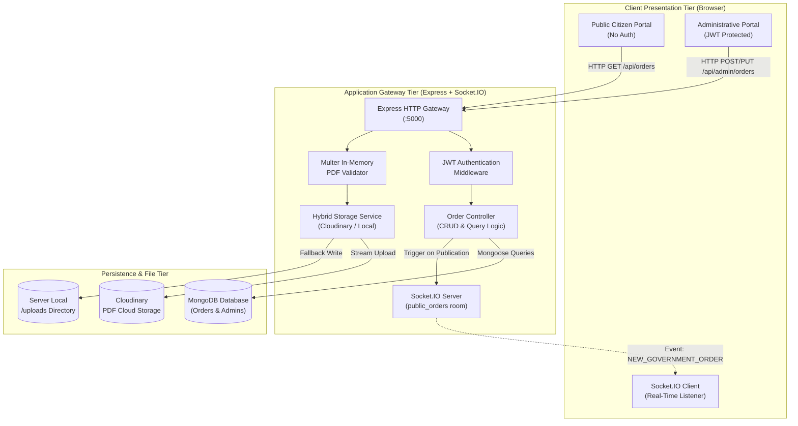
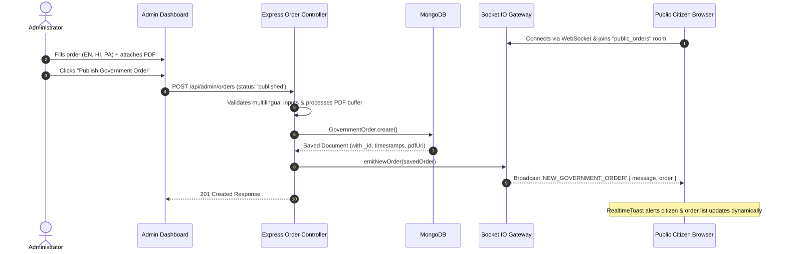

# System Architecture & Technical Specifications

## e-RajPatra: Real-Time Multi-Lingual Government Order Publishing Platform

---

## 1. High-Level Architectural Overview

The platform is designed around a decoupled, three-tier architectural pattern:
1. **Client Presentation Tier (React + Vite SPA):** Responsive user interface featuring distinct citizen and administrative views, multilingual context state, and Socket.IO client listeners.
2. **Application & Real-Time Gateway Tier (Node.js + Express + Socket.IO):** Stateless RESTful APIs for administrative and public queries coupled with a persistent WebSocket server for instantaneous push broadcasting.
3. **Data & Storage Persistence Tier (MongoDB + Cloudinary / Local Engine):** Document database storing multilingual schemas with full-text indexing, combined with a hybrid cloud/local PDF storage engine.



---

## 2. Frontend Component & State Architecture

### 2.1 State Management (Context API)
The frontend deliberately avoids heavy external state libraries (e.g., Redux) in favor of lightweight, native React Context providers:

1. **`LanguageContext`:**
   - Holds the active language state (`'en'`, `'hi'`, `'pa'`).
   - Persists user choice in `localStorage`.
   - Exposes `t(key)` for static UI string lookup from `translations.js`.
   - Exposes `getLocalized(fieldObj)` which automatically extracts the corresponding language string from multilingual document fields (e.g., `title.hi`).
   - Provides global accessibility controls (font scaling level `A-`, `A`, `A+`).

2. **`AuthContext`:**
   - Manages administrator authentication state, stored JWT tokens, and user profile data.
   - Automatically synchronizes with `localStorage` and validates existing sessions against `/api/auth/me` on application boot.
   - Exposes `login()` and `logout()` methods.

3. **`SocketContext`:**
   - Establishes a singleton WebSocket connection to the backend server.
   - Automatically listens for the `'NEW_GOVERNMENT_ORDER'` event.
   - Manages real-time unread notification counts, notification dropdown history, and the floating interactive `RealtimeToast` popup banner.

---

## 3. Real-Time WebSocket Event Pipeline

The platform uses **Socket.IO** to eliminate the need for citizens to poll the server for new orders. The event pipeline follows this strictly verified sequence:



---

## 4. Hybrid Document Archival Engine (Cloudinary + Local Fallback)

To ensure high availability in production while enabling frictionless local development and college evaluation, the platform implements a **Dual-Engine Storage Strategy**:

- **Detection:** On startup, `cloudinaryService.js` detects whether valid Cloudinary API keys are present in the environment variables.
- **Mode A (Cloud Active):** If valid credentials are supplied, uploaded PDF file buffers are streamed directly to Cloudinary using `streamifier` and `cloudinary.uploader.upload_stream` under the `govt_orders_pdfs` folder.
- **Mode B (Resilient Local Engine):** If Cloudinary credentials are empty or placeholders, the service saves the validated PDF directly to `backend/uploads/` with a sanitized filename and returns the static URI (`/uploads/<filename>`). The Express gateway serves this directory via `express.static`.
- **Result:** The application **never crashes or blocks uploads** due to third-party cloud service quotas or missing keys.

---

## 5. Multilingual Data Modeling & Query Strategy

Government orders must accurately convey legal meaning across regional languages. The platform structures every text field into an immutable trilingual schema:

```json
{
  "title": {
    "en": "National Merit Scholarship Scheme 2026-27 for Undergraduate Students",
    "hi": "स्नातक छात्रों के लिए राष्ट्रीय मेरिट छात्रवृत्ति योजना 2026-27",
    "pa": "ਅੰਡਰਗ੍ਰੈਜੂਏਟ ਵਿਦਿਆਰਥੀਆਂ ਲਈ ਰਾਸ਼ਟਰੀ ਮੈਰਿਟ ਸਕਾਲਰਸ਼ਿਪ ਸਕੀਮ 2026-27"
  },
  "description": {
    "en": "Notification regarding financial assistance...",
    "hi": "अधिसूचना वित्तीय सहायता के संबंध में...",
    "pa": "ਵਿੱਤੀ ਸਹਾਇਤਾ ਸੰਬੰਧੀ ਨੋਟੀਫਿਕੇਸ਼ਨ..."
  }
}
```

### Search Implementation:
To provide seamless search across languages without forcing the user to type in a specific script:
1. **Regex Case-Insensitive Multi-Field Matching:** Queries compare the input against `title.en`, `title.hi`, `title.pa`, `description.en`, `description.hi`, `description.pa`, and `orderNumber`.
2. **Compound Text Indexing:** MongoDB compound text index ensures sub-millisecond query execution even across thousands of archived documents.

---

## 6. Security Architecture

1. **Password Hashing:** Passwords are never stored in plain text. Mongoose `pre('save')` hooks utilize `bcryptjs` with an algorithmic work factor (salt rounds) of 10.
2. **JWT Stateless Authentication:** Tokens are signed with an HMAC-SHA256 secret (`JWT_SECRET`) and carry a 7-day expiration.
3. **Role-Based Route Protection:** The `protectAdmin` middleware extracts and verifies the bearer token from the `Authorization` header and attaches the validated admin instance to `req.admin`.
4. **File Upload Restrictions:** Multer memory storage validates that incoming files have MIME type `application/pdf` and enforces a strict 15MB size ceiling before any processing occurs.
5. **No Public Admin Registration:** The registration endpoint is permanently disabled once the initial bootstrap administrator exists.
